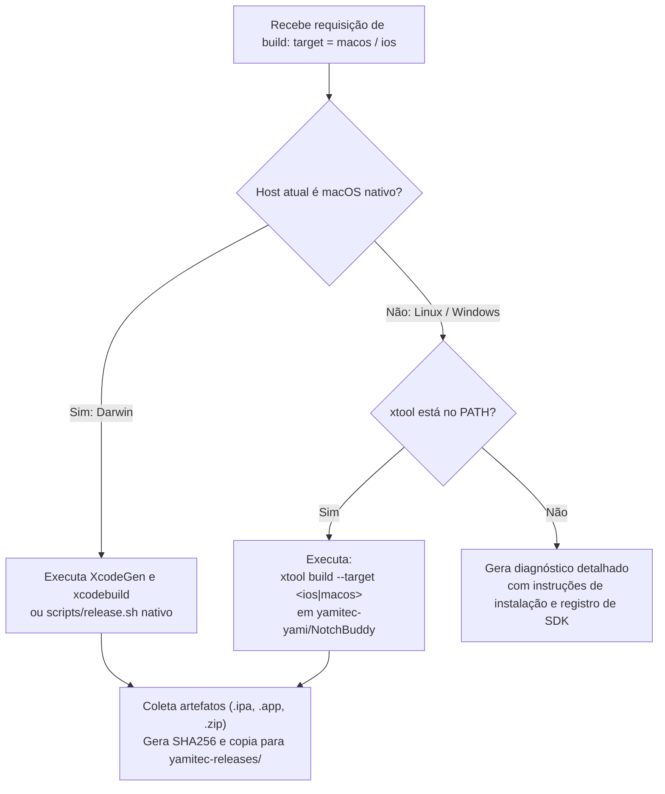

# 🍏 Compilação Cross-Platform de iOS e macOS com `xtool`

Este documento descreve como o ecossistema Yamitec resolve o desafio histórico de compilar aplicações para o ecossistema Apple (iOS e macOS) sem depender obrigatoriamente de uma máquina Mac física ou do aplicativo gráfico do Xcode, utilizando o **`xtool`**.

---

## 🧐 O que é o `xtool`?

O **`xtool`** ([`xtool-org/xtool`](https://github.com/xtool-org/xtool)) é uma ferramenta de linha de comando open-source e multiplataforma desenvolvida para replicar as funcionalidades centrais do Xcode em ambientes alternativos como **Linux** e **Windows (via WSL)**, além de servir como uma alternativa rápida no próprio macOS.

### Capacidades Principais:
1. **Compilação sem Xcode GUI**: Compila pacotes baseados em Swift Package Manager (SwiftPM) e projetos Xcode em binários funcionais para iOS e macOS.
2. **Execução no Linux e Windows**: Permite que servidores CI/CD e estações de trabalho não-Apple compilem e empacotem aplicativos Apple.
3. **Assinatura e Provisioning**: Comunicação com APIs de serviços de desenvolvedor da Apple para assinatura de código.
4. **Deploy Direto**: Instalação e execução de apps em dispositivos físicos iOS via conexão USB a partir do Linux ou Windows.

---

## 🏛️ O Projeto Apple do Yami (`NotchBuddy`)

O código para plataformas Apple do Yami reside no diretório [`yamitec-yami/NotchBuddy/`](../../yamitec-yami/NotchBuddy):
- Contém a definição declarativa de projeto [`project.yml`](../../yamitec-yami/NotchBuddy/project.yml) gerenciada pelo XcodeGen.
- Utiliza **Swift / SwiftUI** nativo para desenhar a ilha dinâmica de interação com o astronauta.
- Inclui os catálogos de recursos visuais `Assets.xcassets` e `PhoneAssets.xcassets`.

---

## ⚙️ Como o Orchestrator Roteia os Builds

Quando uma solicitação de build para `macos` ou `ios` chega ao **YamiTec AI Orchestrator**:



### Regras do Roteador de Compilação:
1. **Ambiente Não-OSX (Linux / Windows)**:
   - O Orchestrator ativa a flag `use_xtool = True`.
   - Se o comando for executado em modo `--dry-run`, valida a presença do projeto `NotchBuddy`, dos catálogos de assets e das dependências Swift.
   - Caso o `xtool` esteja instalado, executa a compilação gerando o executável ou pacote `.ipa`/`.app`.
2. **Ambiente macOS Nativo**:
   - Utiliza a esteira padrão baseada em `xcodegen` e `xcodebuild`.

---

## 🚀 Como Configurar o `xtool` no Servidor do Orchestrator

Para habilitar a compilação real de iOS e macOS no seu servidor Linux ou Windows:

### 1. Instalação do CLI `xtool`

No Linux ou WSL:
```bash
curl -fsSL https://xtool.sh/install.sh | bash
```

Ou compilando diretamente com Rust / Cargo:
```bash
cargo install --git https://github.com/xtool-org/xtool.git
```

### 2. Registro do SDK Darwin / Apple
O `xtool` não redistribui os SDKs proprietários da Apple por questões de licenciamento. Você fornece um arquivo oficial `.xip` do Xcode (baixado do [Apple Developer Portal](https://developer.apple.com/download/all/)):

```bash
# Registra os SDKs de iOS e macOS contidos no Xcode.xip
xtool sdk add /caminho/para/Xcode_16.xip
```

Para verificar os SDKs registrados:
```bash
xtool sdk list
```

### 3. Teste do Pipeline
Após registrado, qualquer build disparado pelo Orchestrator ou via MCP compilará os binários do Yami sem necessidade de intervenção manual:

```powershell
# No PowerShell do Hub:
.\yamitec-hub.ps1 build-yami -Target ios
```
